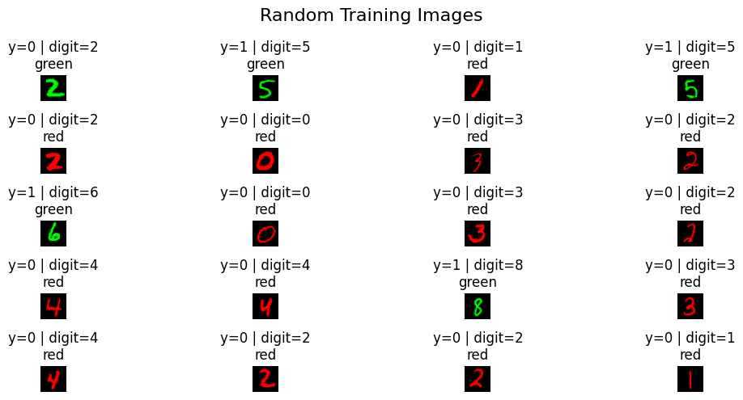
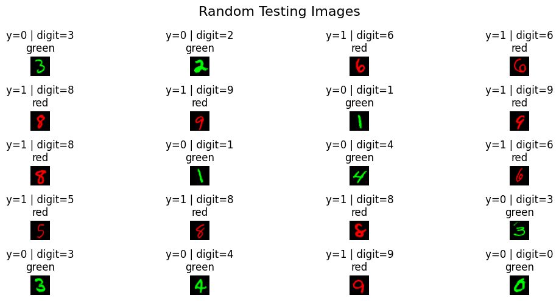
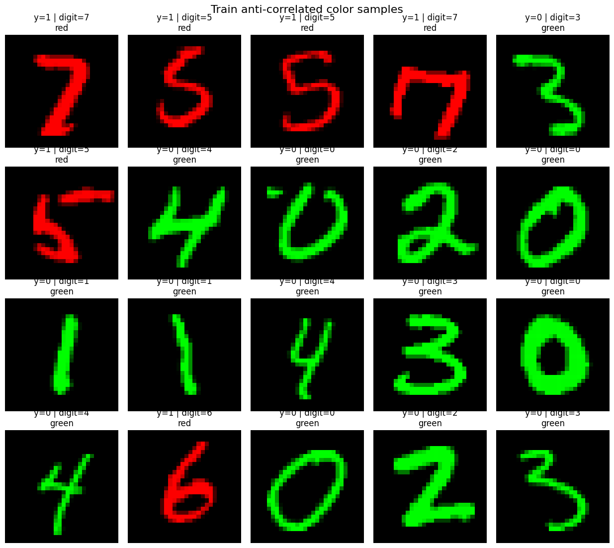
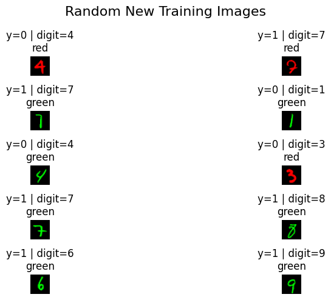
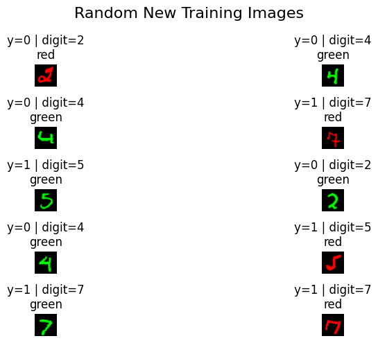

# Beyond Color: Mitigating Spurious Correlations in Colored MNIST

**A Trustworthy AI experiment on shortcut learning, distribution shift, and error-based data reweighting.**

Can a classifier learn to recognize handwritten digits instead of relying on a color that happens to predict the label? This project constructs a deliberately biased version of MNIST, measures how ordinary empirical risk minimization (ERM) behaves when the color–label relationship is reversed, and experiments with **Just Train Twice (JTT)** and **Generalized Cross Entropy (GCE)** to reduce dependence on that shortcut.

> **Headline result:** On the fully color-reversed test set, the recorded final accuracy rises from **64.49%** for the two-epoch ERM baseline to **90.72%** for the best-performing GCE-assisted, two-stage configuration. These are results from **one notebook run**, not averages across seeds.

## The problem: a shortcut that fails under distribution shift

Each original MNIST digit is converted into a binary classification example:

```math
y = \begin{cases}
0, & \text{digit} \in \{0,1,2,3,4\} \\
1, & \text{digit} \in \{5,6,7,8,9\}
\end{cases}
```

The grayscale image is placed entirely in either the **red channel** (`color_id = 0`) or the **green channel** (`color_id = 1`). Color is a *spurious attribute*: it is useful for predicting the target in training but is not the digit information we want the classifier to learn.

| Split | Examples | Color–label relationship | Purpose |
| --- | ---: | --- | --- |
| Training | 60,000 | Color agrees with the binary label with probability **0.95** | Encourages shortcut learning |
| Testing | 10,000 | Color is **always opposite** the binary label | Tests performance when the shortcut reverses |

Writing `c` for the color ID and `y` for the binary digit label:

```math
P(c=y\mid\text{train}) = 0.95, \qquad P(c=1-y\mid\text{test}) = 1.
```

In the generated training split, **3,006 / 60,000 (5.01%)** examples are *bias-conflicting* (`c != y`). The test split is entirely bias-conflicting by construction.

### What the data looks like

**Training samples:** Color usually agrees with the label, but a minority of examples break that correlation.



**Test samples:** Every example has the color–label association reversed.



**Bias-conflicting training examples:** These rare cases contain the counterexamples the shortcut-learning model is likely to struggle with.



## Approach

The notebook keeps the classifier architecture fixed and changes **which examples receive emphasis during training**, and, in one variant, the **loss function**.

### Model and training setup

A small multilayer perceptron (MLP) is used throughout:

```text
RGB image (3 × 28 × 28)
    → Flatten (2,352 features)
    → Linear (2,352 → 128)
    → ReLU
    → Linear (128 → 2)
    → Class logits
```

| Setting | Value |
| --- | --- |
| Framework | PyTorch |
| Optimizer | Adam |
| Learning rate | `1e-3` |
| Batch size | `128` |
| Random seed | `9` |
| Initial / error-identification training | `2` epochs |
| Second-stage training | `3` epochs |
| Error-set upsampling factor (`U`) | `50` |
| GCE exponent (`q`) | `0.3` |
| Device | CUDA if available; otherwise CPU |

Random seeds and deterministic-algorithm settings are configured in the notebook; exact numerical reproduction may still depend on the PyTorch version and hardware.

### 1. ERM: establish the shortcut-learning baseline

Train the MLP for **two epochs** with standard cross-entropy on the biased training set. It achieves **97.02% training accuracy**, but only **64.49% accuracy on the color-reversed test set** at the end of epoch 2.

The large train–test gap is consistent with reliance on the training correlation, although the notebook does not directly measure feature attribution.

### 2. JTT-style training: learn from the first model's mistakes

The notebook follows the core *Just Train Twice* idea:

1. **Train an initial ERM model** on the original biased training data.
2. **Identify its mistakes** by collecting indices it misclassifies on the training set. The recorded ERM error set contains **1,208 examples**.
3. **Upsample those indices** by appending each selected example `U = 50` additional times to the full original dataset.
4. **Train a fresh MLP** from scratch, using standard cross-entropy on the enlarged dataset for three epochs.

For a training set of size `N` and an error set `E`, the resulting dataset size is:

```math
N_{\mathrm{up}} = N + U|E|.
```

Equivalently, the second-stage multiplicity of training example `i` is:

```math
w_i = 1 + U\,\mathbf{1}[i\in E].
```

A selected example therefore appears **51 times in total**: once in the original dataset and 50 additional copies. In this run, that gives **120,400** training entries in the ERM-selected JTT dataset. The final JTT-style model reaches **89.03%** accuracy on the reversed-color test set.



### 3. GCE-assisted error identification

The next experiment replaces cross-entropy with **Generalized Cross Entropy (GCE)** when training the *first-stage* model. The implemented per-example loss is:

```math
\mathcal{L}_{\mathrm{GCE}}(p_y;q) = \frac{1-p_y^q}{q}, \qquad q=0.3,
```

where `p_y` is the predicted probability assigned to the correct class. GCE has been used in bias-focused training because it can emphasize examples that are easier for a biased model to learn. Here it is tested as a way of producing a **different first-stage error set**; this is **not** a full implementation of the *Learning from Failure* algorithm.

After two epochs, the GCE first-stage model has **61.14%** reversed-color test accuracy and misclassifies **1,236** training examples. Repeating the same `U = 50` upsampling procedure yields **121,800** entries.



Two fresh second-stage MLPs are then trained on **that same GCE-selected enlarged dataset**:

- **Cross-entropy second stage:** final test accuracy **89.93%**.
- **GCE second stage (`q = 0.3`):** final test accuracy **90.72%**.

This separates the choice of **error-set selector** from the choice of **second-stage loss**.

## Results

All accuracies below are copied from the **last logged epoch** of the uploaded notebook, evaluated on the test set with the fully reversed color correlation.

| Experiment | First-stage error selector | Final training loss | Final-stage epochs | Reversed-color test accuracy |
| --- | --- | --- | ---: | ---: |
| **ERM baseline** | — | Cross-entropy | 2 (single stage) | **64.49%** |
| **JTT-style** | ERM (1,208 errors) | Cross-entropy | 3 | **89.03%** |
| **GCE selector only** | — | GCE (`q = 0.3`) | 2 (single stage) | **61.14%** |
| **GCE-selected JTT** | GCE (1,236 errors) | Cross-entropy | 3 | **89.93%** |
| **GCE-selected JTT + GCE loss** | GCE (1,236 errors) | GCE (`q = 0.3`) | 3 | **90.72%** |

The largest recorded increase over the ERM baseline is **26.23 percentage points** (`90.72 − 64.49`). Within the two-stage variants, replacing the ERM-generated error set with the GCE-generated error set and applying GCE in the final stage yields the highest logged test accuracy.

**Interpretation:** Increasing the emphasis on training examples that an initial classifier gets wrong substantially improves performance when the spurious color cue is reversed. The GCE-selected dataset provides a modest additional benefit in these recorded runs. This is evidence for the approach *in this synthetic setting*, not a claim of general robustness across datasets.

## Run the notebook

### 1. Install dependencies

Use Python 3 with a recent PyTorch installation:

```bash
python -m venv .venv
source .venv/bin/activate  # Windows PowerShell: .venv\Scripts\Activate.ps1
pip install -r requirements.txt
```

### 2. Download the original MNIST IDX files

The notebook **reads four gzip-compressed IDX files directly**; it does not download the dataset automatically and does not use the `torchvision.datasets.MNIST` loader. Put these files inside a folder named **`Mnist/`**, relative to where you launch Jupyter:

```text
Mnist/
├── train-images-idx3-ubyte.gz
├── train-labels-idx1-ubyte.gz
├── t10k-images-idx3-ubyte.gz
└── t10k-labels-idx1-ubyte.gz
```

To download the files from the [CVDF-hosted MNIST mirror](https://github.com/cvdfoundation/mnist) used by common dataset libraries, run this from the repository root:

```bash
python - <<'PY'
from pathlib import Path
from urllib.request import urlretrieve

folder = Path("Mnist")
folder.mkdir(exist_ok=True)
base_url = "https://storage.googleapis.com/cvdf-datasets/mnist/"
files = [
    "train-images-idx3-ubyte.gz",
    "train-labels-idx1-ubyte.gz",
    "t10k-images-idx3-ubyte.gz",
    "t10k-labels-idx1-ubyte.gz",
]
for filename in files:
    print("Downloading", filename)
    urlretrieve(base_url + filename, folder / filename)
PY
```

**Keep the files compressed**: the notebook uses `gzip.open` to read them.

### 3. Execute the experiment

```bash
jupyter notebook spurious-cor.ipynb
```

Run the cells **top to bottom**. They create the biased datasets, display samples, train the ERM and GCE selectors, construct the two enlarged datasets, and train the second-stage models. The notebook prints each epoch's train and test accuracy; the figures in `assets/` are extracted from its saved outputs.

## Repository layout

```text
.
├── README.md
├── spurious-cor.ipynb           # Original experiment and saved outputs
├── requirements.txt
├── assets/
│   ├── train-examples.png
│   ├── test-examples.png
│   ├── minority-train-examples.png
│   ├── erm-error-upsampling.png
│   └── gce-error-upsampling.png
└── Mnist/                       # Download locally; excluded from Git
```

## Scope and limitations

- **One run, one seed:** There are no repeated-seed statistics, uncertainty intervals, or hyperparameter sweeps in the notebook.
- **A deliberately extreme shift:** The test color is reversed for **100%** of examples. Test accuracy here is *not* ordinary IID MNIST accuracy, and the notebook does not report separate group-wise accuracy metrics.
- **Different training budgets:** The ERM baseline trains for two epochs, while second-stage models train for three epochs on enlarged datasets. The comparison is descriptive, not a controlled compute-matched ablation.
- **No independent validation split:** The notebook evaluates on the test set each epoch; a more rigorous study would use a separate validation split for method selection and reserve the test split for final reporting.
- **Methods are adaptations:** The JTT-style procedure selects examples by training misclassification, and the GCE extension changes the selector and/or final loss. It does not reproduce every evaluation or validation protocol of the original JTT paper, nor does it train the coupled models of *Learning from Failure*.

## References

1. Liu, E. Z., et al. (2021). [*Just Train Twice: Improving Group Robustness without Training Group Information*](https://proceedings.mlr.press/v139/liu21f.html). ICML. — Inspiration for error-set identification and second-stage upsampling.
2. Nam, J., et al. (2020). [*Learning from Failure: De-biasing Classifier from Biased Classifier*](https://papers.neurips.cc/paper_files/paper/2020/hash/eddc3427c5d77843c2253f1e799fe933-Abstract.html). NeurIPS. — Motivation for using a deliberately biased predictor and GCE in spurious-correlation settings.
3. Zhang, Z., & Sabuncu, M. R. (2018). [*Generalized Cross Entropy Loss for Training Deep Neural Networks with Noisy Labels*](https://arxiv.org/abs/1805.07836). NeurIPS. — Original GCE loss formulation.
4. LeCun, Y., Cortes, C., & Burges, C. J. [*The MNIST Database of Handwritten Digits*](https://yann.lecun.org/exdb/mnist/). — Source dataset.

---

*This repository documents an educational Trustworthy AI experiment focused on robustness to spurious correlations; all numerical results and sample images come from the included notebook.*
